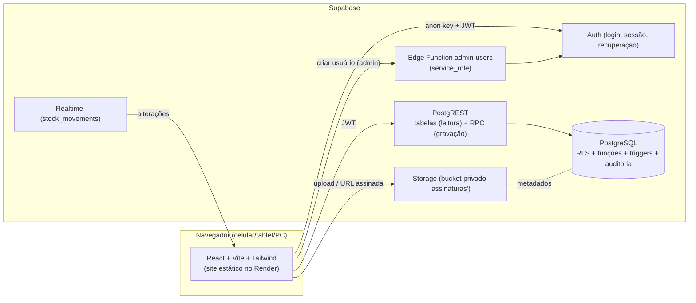
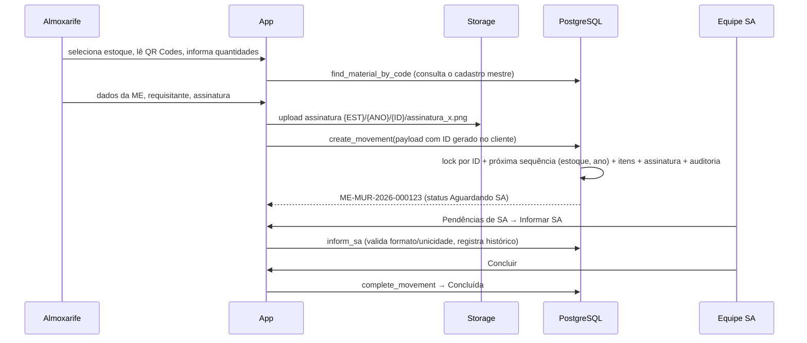
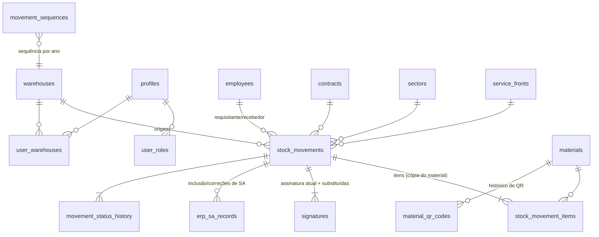

# Arquitetura e decisões — Baixas de Estoque por QR Code

Documento de referência que antecede o código (item 33 da especificação).

## 1. Entendimento do problema

Os almoxarifados de **Muribeca** e **Dois Irmãos** fazem saídas de material ao mesmo tempo. Hoje cada saída gera um formulário em papel "MOVIMENTAÇÃO DE ESTOQUE" (ME). Depois da retirada, outra equipe lança a saída no ERP e recebe um número de **SA**, que precisa ser vinculado à ME.

O sistema digitaliza esse ciclo:

- leitura do QR Code do material;
- montagem da ME com um ou vários itens;
- identificação do requisitante e assinatura digital de quem recebe;
- numeração única da ME;
- acompanhamento das pendências de SA;
- histórico, auditoria e exportação para Excel.

## 2. Premissas adotadas

| Premissa | Decisão |
|---|---|
| ME só existe depois de confirmada pelo banco | O rascunho fica no `sessionStorage` do navegador apenas para não perder o preenchimento. A ME é gravada numa única transação, já com status **Aguardando SA** (ou **Aguardando aprovação**, se o parâmetro estiver ligado). |
| Requisitante/recebedor não precisam de login | Ficam na tabela `employees` (matrícula). Usuários do sistema ficam em `profiles` (Supabase Auth). |
| Por padrão, quem recebe e assina é o próprio requisitante | O almoxarife pode indicar outro funcionário como recebedor. |
| Campos obrigatórios da ME | Estoque, contrato, setor, requisitante, ≥1 item e assinatura. Frente/equipamento, OS, AF e local são opcionais (OS e AF aceitam texto livre e vinculam ao cadastro quando o código existir). |
| Leitura repetida do mesmo material | Soma na linha existente. Linhas separadas só se o parâmetro permitir. |
| Atendida > solicitada | Bloqueado, salvo se o parâmetro for ligado. |
| Número da SA | Único entre MEs não canceladas (parâmetro) e com formato validado por expressão regular configurável. |
| Acesso por estoque | Almoxarife, equipe SA e gestor operam somente nos estoques vinculados. O administrador acessa todos. |
| Saída offline | Não há sincronização offline no MVP. Existem reenvio seguro, idempotência e preservação do preenchimento. |
| PDF | Gerado pelo próprio navegador ("Imprimir / Salvar como PDF") com layout fiel ao formulário em papel. |

## 3. Arquitetura

- **Front-end estático** (Render Static Site). O front-end só conhece a URL e a chave **anon**.
- **Toda regra crítica fica no banco**:
  - funções `SECURITY DEFINER` com verificação explícita de perfil e estoque;
  - RLS em todas as tabelas;
  - triggers de integridade e auditoria.
  - Esconder botões é apenas conveniência de interface.
- A **service_role** fica restrita a dois lugares:
  - a Edge Function `admin-users` (criação de usuários);
  - os scripts locais de dados fictícios.
- **Realtime** atualiza painel, lista e pendências quando uma ME muda. O Realtime respeita a RLS.

## 4. Fluxo operacional

Ciclo de status da ME:

| De | Para | Quando |
|---|---|---|
| (criação) | **Aguardando SA** | ME confirmada pelo banco (sem exigência de aprovação) |
| (criação) | **Aguardando aprovação** | ME confirmada pelo banco, com o parâmetro de aprovação ligado |
| Aguardando aprovação | Aguardando SA | Gestor aprova |
| Aguardando SA | **SA informada** | Equipe SA informa o número (ou direto **Concluída**, se a conclusão automática estiver ligada) |
| SA informada | **Concluída** | Equipe SA valida e conclui |
| Qualquer status | **Cancelada** | Gestor cancela, com justificativa. É um cancelamento lógico. |

`rascunho` e `aguardando_assinatura` existem no tipo do banco para evolução futura. No MVP, o rascunho vive no navegador e a ME já nasce assinada.

## 5. Perfis e permissões

| Ação | Almoxarife | Equipe SA | Gestor | Admin |
|---|:-:|:-:|:-:|:-:|
| Consultar MEs/painel dos estoques vinculados | ✔ | ✔ | ✔ | ✔ (todos) |
| Registrar saída (QR, assinatura) | ✔ | | ✔ | ✔ |
| Informar/corrigir SA (até "SA informada") | | ✔ | ✔ | ✔ |
| Corrigir SA de ME concluída | | | ✔ | ✔ |
| Concluir | | ✔ | ✔ | ✔ |
| Aprovar, cancelar, correção administrativa, nova assinatura | | | ✔ | ✔ |
| Exportar Excel | | ✔ | ✔ | ✔ |
| Auditoria | | | ✔ (seus estoques) | ✔ |
| Cadastros, usuários, perfis, parâmetros | | | | ✔ |

A mesma matriz está em `src/lib/constants.ts` (interface) e nas funções e policies SQL (banco).

## 6. Modelo do banco

Também existem as tabelas auxiliares:

- `service_orders`, `fixed_assets`, `application_locations`, `accounts`, `material_categories`;
- `app_settings` (parâmetros);
- `audit_logs` (somente inserção).

Pontos-chave:

- **ID técnico** (UUID) separado do **número visível** da ME (`UNIQUE`).
- O UUID da ME é gerado no cliente e funciona como **chave de idempotência**: reenviar o mesmo formulário devolve a mesma ME.
- **Cópia dos dados do material** na linha do item: código, referência, nome, unidade, localização e conta. Alterar o cadastro mestre não muda MEs já emitidas.
- Requisitante e recebedor também têm nome e matrícula copiados na ME.
- **Totais** (`item_count`, `total_requested`, `total_delivered`) são mantidos por trigger.
- **Exclusão física bloqueada** por trigger em MEs, assinaturas, SAs, histórico e sequências. A única exceção é o script de remoção de dados fictícios.
- Registros auxiliares são **inativados**, nunca excluídos.

## 7. Regras de negócio

1. **Numeração.** A numeração usa `INSERT ... ON CONFLICT DO UPDATE` em `movement_sequences(warehouse_id, year)`.
   - A linha fica bloqueada até o fim da transação, então saídas simultâneas recebem números diferentes.
   - Se a transação falhar, o número volta (não há buracos).
   - O formato é configurável: `{PREFIXO}-{ESTOQUE}-{ANO}-{SEQ}`.
   - Foi testado com 80 criações paralelas: zero duplicidades e zero buracos.
2. **Duplo envio.** O botão trava, há uma trava síncrona no cliente e um `pg_advisory_xact_lock` pelo ID no banco. No teste, 8 envios simultâneos do mesmo ID geraram 1 ME.
3. **Assinatura.** É obrigatória e não pode estar vazia.
   - O arquivo precisa existir no bucket e no caminho do próprio estoque, ano e ID.
   - A tabela guarda bucket, caminho, tipo, tamanho, data e usuário.
   - A assinatura é imutável. A substituição exige gestor/admin e justificativa, e mantém a anterior.
4. **Edição por status:**

   | Status | O que pode ser alterado |
   |---|---|
   | Aguardando SA | Dados bloqueados; a SA pode ser informada |
   | SA informada | Correção da SA com justificativa |
   | Concluída | Somente correção autorizada (gestor/admin) com justificativa |
   | Cancelada | Somente consulta |

   O estoque de origem só muda por correção autorizada.
5. **Auditoria.** Um trigger genérico grava valores antes e depois (apenas campos alterados), usuário, data/hora, justificativa, origem, IP e user-agent.
   - Cobre ME, itens, assinaturas, SA, cadastros, papéis e parâmetros.
   - Eventos de interface também são registrados: impressão, exportação, consulta de assinatura, QR não localizado e etiquetas.
   - A tabela de auditoria não aceita UPDATE nem DELETE.

## 8. Telas

| # | Tela | Rota |
|---|---|---|
| 1-2 | Login, Recuperação e redefinição de senha | `/login`, `/recuperar-senha`, `/redefinir-senha` |
| 3 | Painel (cards + gráficos + filtros globais) | `/` |
| 4-13 | Nova saída: estoque → leitura QR / pesquisa → carrinho → dados → requisitante → assinatura → revisão → ME gerada | `/nova-saida` |
| 14 | Lista de movimentações (filtros, ordenação, paginação no servidor) | `/movimentacoes` |
| 15, 18 | Detalhes da ME + histórico/auditoria + impressão/PDF | `/movimentacoes/:id` |
| 16-17 | Pendências de SA + inclusão/correção/conclusão | `/pendencias-sa` |
| 19-21 | Materiais, geração de QR Code, importação, etiquetas | `/cadastros/materiais`, `/cadastros/etiquetas` |
| 22 | Funcionários | `/cadastros/funcionarios` |
| 23-24 | Usuários; perfis e permissões | `/admin/usuarios`, `/admin/perfis` |
| 25-26 | Estoques; cadastros auxiliares | `/cadastros/estoques`, `/cadastros/auxiliares` |
| 27 | Auditoria | `/admin/auditoria` |
| 28 | Exportação Excel (resumo/itens) | `/exportar` |
| 29 | Configurações (numeração, regras, SA) | `/admin/configuracoes` |

## 9. Segurança

- O navegador usa apenas a chave **anon**. A service_role nunca vai para o Render nem para o bundle.
- RLS habilitada em todas as tabelas.
  - Não há policy de INSERT/UPDATE/DELETE nas tabelas de movimentação. Gravação só via RPC.
  - Privilégios de tabela também foram revogados (defesa em profundidade).
- Funções RPC: `SECURITY DEFINER` com `search_path` fixo, verificação de perfil ativo, de papel e de estoque.
- `EXECUTE` foi revogado de `anon` em todas as funções. Funções internas não podem ser chamadas pelo cliente.
- Storage:
  - buckets privados;
  - upload só no estoque autorizado, no padrão de pasta, em formato de imagem;
  - leitura por URL assinada de 5 minutos;
  - não há policy de UPDATE/DELETE.
- Usuário inativo perde efeito de todos os papéis imediatamente, porque as funções checam `profiles.active`.
- Cabeçalhos de segurança configurados no Render: HSTS, X-Frame-Options, `Permissions-Policy` com câmera só para o próprio domínio.

## 10. Deploy

- **Supabase:**
  - executar `supabase/instalar_completo.sql` (ou os arquivos 01→08);
  - criar o primeiro usuário e rodar `bootstrap_admin`;
  - publicar a Edge Function `admin-users`;
  - opcional: dados fictícios.
- **Render:** Blueprint `render.yaml` (Static Site).
  - Build: `npm ci && npm run build`.
  - Publicação: `dist`.
  - Rewrite `/* → /index.html`, que evita 404 em rotas internas.
  - Variáveis `VITE_SUPABASE_URL` e `VITE_SUPABASE_ANON_KEY`.
- **Atualização:** `git push` na branch `main` dispara novo deploy automático.
  - Mudanças de banco: executar o script SQL alterado. Os scripts são reexecutáveis (`create or replace`, `if not exists`).

Passo a passo completo no `README.md`.
