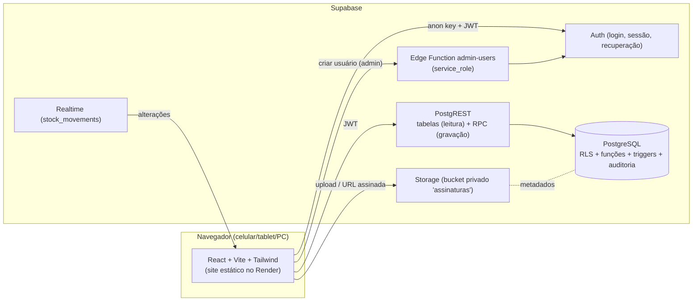
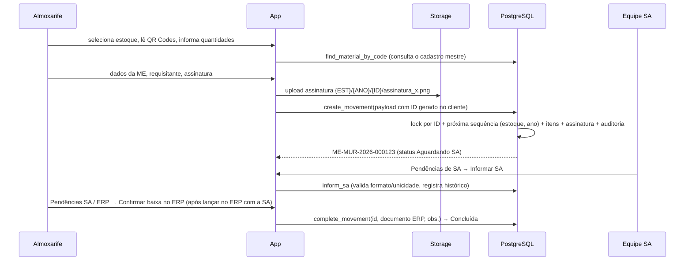
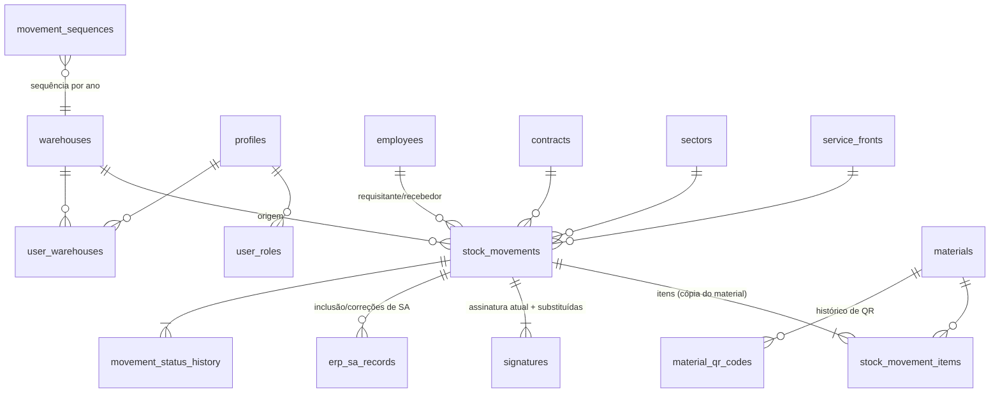

# Arquitetura e decisões — Baixas de Estoque por QR Code

Documento de referência que antecede o código (item 33 da especificação).

## 1. Entendimento do problema

Os almoxarifados de **Muribeca** e **Dois Irmãos** fazem saídas de material ao mesmo tempo. Hoje cada saída gera um formulário em papel "MOVIMENTAÇÃO DE ESTOQUE" (ME). Depois da retirada, outra equipe lança a saída no ERP e recebe um número de **SA**, que precisa ser vinculado à ME.

O sistema digitaliza esse ciclo:

- leitura do QR Code do material;
- montagem da ME com um ou vários itens;
- identificação do requisitante e assinatura digital de quem recebe;
- numeração única da ME;
- acompanhamento das pendências de SA;
- histórico, auditoria e exportação para Excel.

## 2. Premissas adotadas

| Premissa | Decisão |
|---|---|
| ME só existe depois de confirmada pelo banco | O rascunho fica no `sessionStorage` do navegador apenas para não perder o preenchimento. A ME é gravada numa única transação, já com status **Aguardando SA** (ou **Aguardando aprovação**, se o parâmetro estiver ligado). |
| Requisitante/recebedor não precisam de login | Ficam na tabela `employees` (matrícula). Usuários do sistema ficam em `profiles` (Supabase Auth). |
| Por padrão, quem recebe e assina é o próprio requisitante | O almoxarife pode indicar outro funcionário como recebedor. |
| Campos obrigatórios da ME | Estoque, contrato, setor, requisitante, ≥1 item e assinatura. Frente/equipamento, OS, AF e local são opcionais (OS e AF aceitam texto livre e vinculam ao cadastro quando o código existir). |
| Leitura repetida do mesmo material | Soma na linha existente. Linhas separadas só se o parâmetro permitir. |
| Atendida > solicitada | Bloqueado, salvo se o parâmetro for ligado. |
| Número da SA | Único entre MEs não canceladas (parâmetro) e com formato validado por expressão regular configurável. |
| Catálogo de materiais compartilhado | Decisão do responsável pelo projeto em 19/11/2026: Muribeca e Dois Irmãos utilizam um único cadastro mestre de materiais. A consulta é permitida aos usuários ativos com papel autorizado; inclusão, alteração e importação seguem as permissões de cadastro. O catálogo compartilhado não concede acesso a movimentações de estoques não autorizados. |
| Acesso por estoque | Almoxarife, equipe SA e gestor operam somente nos estoques vinculados. O administrador acessa todos. |
| Saída offline | Não há sincronização offline no MVP. Existem reenvio seguro, idempotência e preservação do preenchimento. |
| PDF | Gerado pelo próprio navegador ("Imprimir / Salvar como PDF") com layout fiel ao formulário em papel. |

## 3. Arquitetura

- **Front-end estático** (Render Static Site). O front-end só conhece a URL e a chave **anon**.
- **Toda regra crítica fica no banco**:
  - funções `SECURITY DEFINER` com verificação explícita de perfil e estoque;
  - RLS em todas as tabelas;
  - triggers de integridade e auditoria.
  - Esconder botões é apenas conveniência de interface.
- A **service_role** fica restrita a dois lugares:
  - a Edge Function `admin-users` (criação de usuários);
  - os scripts locais de dados fictícios.
- **Realtime** atualiza painel, lista e pendências quando uma ME muda. O Realtime respeita a RLS.

## 4. Fluxo operacional

Ciclo de status da ME:

| De | Para | Quando |
|---|---|---|
| (criação) | **Aguardando SA** | ME **com ativo fixo** confirmada pelo banco (sem exigência de aprovação) |
| (criação) | **SA informada** sem número (tela: *Aguardando baixa no ERP*) | ME **sem ativo fixo**: não passa pela SA (`requires_sa = false`); vai direto para o almoxarife lançar no ERP |
| (criação) | **Aguardando aprovação** | ME confirmada pelo banco, com o parâmetro de aprovação ligado |
| Aguardando aprovação | Aguardando SA (ou direto para a baixa no ERP, se não tiver ativo fixo) | Gestor aprova |
| Aguardando SA | **SA informada** (tela: *Aguardando baixa no ERP*) | Equipe SA informa o número (ou direto **Concluída**, se a conclusão automática estiver ligada) |
| SA informada | **Concluída** | Almoxarife faz a baixa no ERP com a SA e confirma no sistema (documento ERP e observação opcionais, gravados no histórico) |
| Qualquer status | **Cancelada** | Gestor cancela, com justificativa. É um cancelamento lógico. |

`rascunho` e `aguardando_assinatura` existem no tipo do banco para evolução futura. No MVP, o rascunho vive no navegador e a ME já nasce assinada.

## 5. Perfis e permissões

| Ação | Almoxarife | Equipe SA | Gestor | Admin |
|---|:-:|:-:|:-:|:-:|
| Consultar MEs/painel dos estoques vinculados | ✔ | ✔ | ✔ | ✔ (todos) |
| Registrar saída (QR, assinatura) | ✔ | | ✔ | ✔ |
| Informar/corrigir SA (até "SA informada") | | ✔ | ✔ | ✔ |
| Corrigir SA de ME concluída | | | ✔ | ✔ |
| Confirmar baixa no ERP (conclui a ME) | ✔ (estoques dele) | | ✔ | ✔ |
| Aprovar, cancelar, correção administrativa, nova assinatura | | | ✔ | ✔ |
| Exportar Excel | | ✔ | ✔ | ✔ |
| Auditoria | | | ✔ (seus estoques) | ✔ |
| Cadastros, usuários, perfis, parâmetros | | | | ✔ |

A mesma matriz está em `src/lib/constants.ts` (interface) e nas funções e policies SQL (banco).

## 6. Modelo do banco

Também existem as tabelas auxiliares:

- `service_orders`, `fixed_assets`, `application_locations`, `accounts`, `material_categories`;
- `app_settings` (parâmetros);
- `audit_logs` (somente inserção).

Pontos-chave:

- **ID técnico** (UUID) separado do **número visível** da ME (`UNIQUE`).
- O UUID da ME é gerado no cliente e funciona como **chave de idempotência**: reenviar o mesmo formulário devolve a mesma ME.
- **Cópia dos dados do material** na linha do item: código, referência, nome, unidade, localização e conta. Alterar o cadastro mestre não muda MEs já emitidas.
- Requisitante e recebedor também têm nome e matrícula copiados na ME.
- **Totais** (`item_count`, `total_requested`, `total_delivered`) são mantidos por trigger.
- **Exclusão física bloqueada** por trigger em MEs, assinaturas, SAs, histórico e sequências. A única exceção é o script de remoção de dados fictícios.
- Registros auxiliares são **inativados**, nunca excluídos.

## 7. Regras de negócio

1. **Numeração.** A numeração usa `INSERT ... ON CONFLICT DO UPDATE` em `movement_sequences(warehouse_id, year)`.
   - A linha fica bloqueada até o fim da transação, então saídas simultâneas recebem números diferentes.
   - Se a transação falhar, o número volta (não há buracos).
   - O formato é configurável: `{PREFIXO}-{ESTOQUE}-{ANO}-{SEQ}`.
   - Foi testado com 80 criações paralelas: zero duplicidades e zero buracos.
2. **Duplo envio.** O botão trava, há uma trava síncrona no cliente e um `pg_advisory_xact_lock` pelo ID no banco. No teste, 8 envios simultâneos do mesmo ID geraram 1 ME.
3. **Assinatura.** É obrigatória e não pode estar vazia.
   - O arquivo precisa existir no bucket e no caminho do próprio estoque, ano e ID.
   - A tabela guarda bucket, caminho, tipo, tamanho, data e usuário.
   - A assinatura é imutável. A substituição exige gestor/admin e justificativa, e mantém a anterior.
4. **Edição por status:**

   | Status | O que pode ser alterado |
   |---|---|
   | Aguardando SA | Dados bloqueados; a SA pode ser informada |
   | SA informada | Correção da SA com justificativa |
   | Concluída | Somente correção autorizada (gestor/admin) com justificativa |
   | Cancelada | Somente consulta |

   O estoque de origem só muda por correção autorizada.
5. **Auditoria.** Um trigger genérico grava valores antes e depois (apenas campos alterados), usuário, data/hora, justificativa, origem, IP e user-agent.
   - Cobre ME, itens, assinaturas, SA, cadastros, papéis e parâmetros.
   - Eventos de interface também são registrados: impressão, exportação, consulta de assinatura, QR não localizado e etiquetas.
   - A tabela de auditoria não aceita UPDATE nem DELETE.

## 8. Telas

| # | Tela | Rota |
|---|---|---|
| 1-2 | Login, Recuperação e redefinição de senha | `/login`, `/recuperar-senha`, `/redefinir-senha` |
| 3 | Painel (cards + gráficos + filtros globais) | `/` |
| 4-13 | Nova saída: estoque → leitura QR / pesquisa → carrinho → dados → requisitante → assinatura → revisão → ME gerada | `/nova-saida` |
| 14 | Lista de movimentações (filtros, ordenação, paginação no servidor) | `/movimentacoes` |
| 15, 18 | Detalhes da ME + histórico/auditoria + impressão/PDF | `/movimentacoes/:id` |
| 16-17 | Pendências de SA + inclusão/correção/conclusão | `/pendencias-sa` |
| 19-21 | Materiais, geração de QR Code, importação, etiquetas | `/cadastros/materiais`, `/cadastros/etiquetas` |
| 22 | Funcionários | `/cadastros/funcionarios` |
| 23-24 | Usuários; perfis e permissões | `/admin/usuarios`, `/admin/perfis` |
| 25-26 | Estoques; cadastros auxiliares | `/cadastros/estoques`, `/cadastros/auxiliares` |
| 27 | Auditoria | `/admin/auditoria` |
| 28 | Exportação Excel (resumo/itens) | `/exportar` |
| 29 | Configurações (numeração, regras, SA) | `/admin/configuracoes` |

## 9. Segurança

- O navegador usa apenas a chave **anon**. A service_role nunca vai para o Render nem para o bundle.
- RLS habilitada em todas as tabelas.
  - Não há policy de INSERT/UPDATE/DELETE nas tabelas de movimentação. Gravação só via RPC.
  - Privilégios de tabela também foram revogados (defesa em profundidade).
- Funções RPC: `SECURITY DEFINER` com `search_path` fixo, verificação de perfil ativo, de papel e de estoque.
- `EXECUTE` foi revogado de `anon` em todas as funções. Funções internas não podem ser chamadas pelo cliente.
- Storage:
  - buckets privados;
  - upload só no estoque autorizado, no padrão de pasta, em formato de imagem;
  - leitura por URL assinada de 5 minutos;
  - não há policy de UPDATE/DELETE.
- Usuário inativo perde efeito de todos os papéis imediatamente, porque as funções checam `profiles.active`.
- Cabeçalhos de segurança configurados no Render: HSTS, X-Frame-Options, `Permissions-Policy` com câmera só para o próprio domínio.

## 10. Deploy

- **Supabase:**
  - executar `supabase/instalar_completo.sql` (ou os arquivos 01→08);
  - criar o primeiro usuário e rodar `bootstrap_admin`;
  - publicar a Edge Function `admin-users`;
  - opcional: dados fictícios.
- **Render:** Blueprint `render.yaml` (Static Site).
  - Build: `npm ci && npm run build`.
  - Publicação: `dist`.
  - Rewrite `/* → /index.html`, que evita 404 em rotas internas.
  - Variáveis `VITE_SUPABASE_URL` e `VITE_SUPABASE_ANON_KEY`.
- **Atualização:** `git push` na branch `main` dispara novo deploy automático.
  - Mudanças de banco: executar o script SQL alterado. Os scripts são reexecutáveis (`create or replace`, `if not exists`).

Passo a passo completo no `README.md`.

## Atualização: ME sem ativo fixo e importação de cadastros auxiliares (migração 15)

- `stock_movements.requires_sa` é definido na criação: `true` quando a ME tem ativo fixo. Sem ativo, a ME nasce em `sa_informada` sem número de SA e aparece na aba *Aguardando baixa no ERP*; `inform_sa` recusa SA para essas MEs; o almoxarife pode cancelá-las (devolução) até confirmar a baixa.
- A restrição `stock_movements_sa_ck` passou a aceitar `sa_informada`/`concluida` sem SA quando `requires_sa = false`.
- `import_lookups(tabela, linhas)`: importa por planilha ativos fixos, locais de aplicação, contratos, setores, frentes/equipamentos, OS, contas e categorias, atualizando pelo código (admin e almoxarife).

## Balcão de separação (leitor QR sem fio + tablet do solicitante) — migração 16

**Fluxo:** almoxarife abre a separação em `/balcao` → a ME nasce no banco em `rascunho` (*Em separação*), já com número →
cada bipada chama `counter_add` e grava o item na hora → **FINALIZAR SEPARAÇÃO** (`counter_finish`) muda para
`aguardando_assinatura` (*Aguardando confirmação*) e bloqueia leituras → no tablet (`/terminal`, perfil **Terminal**)
o solicitante confere o resumo e toca em **CONFIRMAR ME** → validação (hoje assinatura; facial plugável) →
`counter_confirm` grava a confirmação e a ME segue o fluxo normal (Aguardando SA, ou baixa no ERP se não tiver ativo).

| Tela | Status no banco | Status exibido |
|---|---|---|
| Em separação | `rascunho` | Em separação |
| Aguardando confirmação | `aguardando_assinatura` | Aguardando confirmação |
| Validação / erro de validação | sem mudança de status; cada tentativa vai para `confirmation_attempts` | — |
| ME confirmada | `aguardando_sa` / `sa_informada` / `aguardando_aprovacao` | conforme o fluxo atual |
| Cancelada / estorno | `cancelada` (cancelamento lógico com justificativa) | Cancelada |

**Tabelas novas:** `counter_sessions` (ME ↔ almoxarife ↔ tablet, código de pareamento de 6 dígitos válido por 30 min,
`version` incrementada a cada mudança), `scan_events` (toda leitura, inclusive não encontrada e repetida, com `scan_id` único),
`confirmation_attempts` (tentativas de confirmação: método, resultado, pontuação, prova de vida, consumo único).
**Campos novos em `stock_movements`:** `entry_channel` (`assistente`/`balcao`), `separation_finished_at`, `confirmed_at`, `confirmation_method`.

**Segurança e concorrência**
- Todas as funções do balcão travam a ME (`select … for update`) e só aceitam o almoxarife que abriu a separação.
- `scan_id` gerado por leitura: reenvio pela rede não duplica item; 20 leituras simultâneas somam corretamente (testado).
- Leituras e alterações só em `rascunho`; confirmação só em `aguardando_assinatura`, só pelo tablet pareado e uma única vez.
- O perfil **terminal** não enxerga MEs pelo vínculo de estoque (`can_access_warehouse` ignora esse perfil); vê apenas a ME
  pareada, pela função `counter_snapshot`. Só pareia com separações do estoque a que está vinculado.
- Assinatura do tablet: política de Storage específica, só na pasta da ME pareada e aguardando confirmação.
- "Sucesso" de validação nunca vem do navegador: a assinatura é verificada em `counter_confirm`; o facial será gravado pelo servidor.

**Tempo real:** as telas escutam `counter_sessions` (Supabase Realtime, respeitando RLS) e recarregam a fotografia por
`counter_snapshot`. Sem WebSocket, as telas consultam a cada 3 s; com tempo real, a cada 20 s por garantia.

**Leitor HID:** campo de leitura sempre em foco (volta sozinho), ouvinte global por ritmo de digitação + Enter, ignora a mesma
leitura em menos de 1,5 s, avisos visuais e sonoros (incluído, somado, já incluído, não encontrado, inativo, quantidade inválida,
erro de comunicação, item removido, quantidade alterada).

**Reconhecimento facial (a ligar):** Edge Function com o fornecedor escolhido (com prova de vida) grava em
`confirmation_attempts` (`method='facial'`) com a chave de serviço e devolve o id; o tablet chama
`counter_confirm(me, {method:'facial', verification_id})`. O banco aceita só verificação com sucesso, desta ME, de até 5 minutos
e não utilizada. Ver `src/lib/confirmation.ts`. Exige base legal LGPD (dado biométrico, art. 11) e cadastro facial dos funcionários.

## Alerta de retirada repetida por ativo fixo (migração 18)

`repeat_asset_withdrawals(filtros, dias = 7)` (somente gestor e administrador) lista os casos em que o **mesmo ativo fixo** recebeu o **mesmo material** em MEs
diferentes dentro da janela (7, 15 ou 30 dias no Painel). Considera MEs confirmadas (exclui canceladas e as ainda em separação no balcão),
respeita os filtros do Painel para a ME mais recente e o acesso por estoque (RLS). O Painel mostra um card com o total e um quadro com
ativo, material, número de retiradas, quantidade total, menor intervalo e as MEs envolvidas (com link).

## Modo offline (Nova saída) — migração 19

- **Abrir sem internet:** `public/sw.js` (service worker) guarda o app no aparelho; navegação busca a rede primeiro e,
  sem rede, usa a cópia. A lista de arquivos vem de `/asset-list.json`, gerado no build (`vite.config.ts`). Supabase nunca passa pelo service worker.
- **Cadastros no aparelho (IndexedDB):** materiais (QR e pesquisa), funcionários ativos, tabelas auxiliares e permissões do usuário
  (`src/lib/offlineCache.ts`), atualizados a cada 6 h com internet ou pelo botão em *Saídas offline*.
- **Fila de envio:** sem internet, a revisão vira **Guardar no aparelho**; a saída e a assinatura ficam no IndexedDB
  (`src/lib/offlineQueue.ts`) e são enviadas sozinhas ao reconectar (e a cada 30 s). O id da ME é gerado no aparelho,
  então reenvios não duplicam. O número oficial da ME é gerado no envio.
- **Banco:** `create_movement` aceita `offline_at` (data/hora real da retirada, até 7 dias) e grava `entry_channel = 'offline'`;
  `movement_at` e a assinatura ficam com a data real; `created_at` registra o envio.
- **Limites:** o balcão com tablet exige internet; dados guardados se perdem se o navegador for limpo antes do envio.

## Foto do solicitante na confirmação do balcão (migração 20)

Na confirmação no tablet: **1) foto** pela câmera frontal (JPEG até 800 px) e **2) assinatura**. A foto vai para o bucket privado
`fotos-retirada` (envio só pelo tablet pareado, na pasta da ME aguardando confirmação) e é registrada em `movement_photos`.
Leitura (tabela e arquivo) **somente gestor e administrador**; cada consulta gera o evento de auditoria `me.foto_consultada`.
Sem câmera disponível, a confirmação segue só com assinatura e o motivo fica gravado (`photo_skipped_reason`) na tentativa e na auditoria.
Não há reconhecimento automático do rosto (sem processamento biométrico); a foto é evidência para consulta da gestão.

## Contrato fixo, local de aplicação fixo e ME emergencial (migração 21)

- **Contrato fixo**: `app_settings.default_contract_id` (Configurações › Campos fixos da saída). O balcão e a Nova saída mostram o contrato travado. Sem contrato padrão, se houver um único contrato ativo ele é usado; com vários e nenhum padrão, a tela volta a pedir a escolha. O servidor (`create_movement`, `counter_open`) também aplica o contrato padrão quando nenhum é enviado. A migração define o padrão sozinha quando existe um único contrato ativo.
- **Local de aplicação fixo**: as telas não pedem mais o local; a ME grava `application_location_text = '-'` (o servidor também grava "-" quando nenhum local é enviado). A correção autorizada (gestor/admin) ainda pode alterar.
- **ME emergencial** (`stock_movements.is_emergency`, `emergency_reason` 5–500 caracteres): retirada registrada só para controle.
  - Marcada no balcão ou na Nova saída, com motivo obrigatório.
  - Não exige SA (`requires_sa = false`, mesmo com ativo fixo) e não passa pela aprovação, pela equipe de SA nem pela baixa no ERP.
  - Assistente/offline: nasce **Concluída**. Balcão: fica Concluída quando o solicitante confirma no tablet (foto + assinatura continuam valendo). `completed_at`/`completed_by` registram a conclusão.
  - Aparece com o selo "Emergencial · controle" na lista, no detalhe, no balcão, na impressão e no Excel (colunas Emergencial e Motivo). Filtro "Tipo de ME" (todas / normais / emergenciais) em `movement_matches` (`emergency = 'sim' | 'nao'`).
  - Continua contando no alerta de retirada repetida por ativo.
- Testes: `supabase/tests/70_testes_emergencial.sql` e `tests/e2e/fluxo_emergencial.py`.

## Seletor de estoque do topo
- O estoque escolhido no topo vale para o Painel, Movimentações, Pendências SA/ERP e Exportar (filtro `warehouse_id` na URL acompanha o seletor). A opção **Todos os estoques** mostra o consolidado e fica lembrada no aparelho. Um link com estoque no endereço (ex.: card do Painel) é respeitado ao abrir a tela.

## Auditoria — fase 1 (migração 22)
- **Interface única**: `audit_event(...)` (o antigo `write_audit` só repassa). Classifica cada evento (`category`, `severity`, `actor_type`), grava `result` (sucesso/falha/negado), `reason_code`, `schema_version = 2` e `correlation_id` (um por transação; cabeçalho `x-correlation-id` válido tem prioridade). Grava na mesma transação da operação.
- **Minimização** (`audit_mask`): segredos (`senha`, `token`, `authorization`…) viram `[removido]`; nomes de pessoas `[omitido]`; matrículas `****NN`; e-mail `i***@dominio`; `user_email` não é mais copiado. IP e navegador só em eventos de autenticação/autorização ou com resultado diferente de sucesso. Textos passam por `audit_clean_text` (remove caracteres de controle; limita tamanho). Registros antigos não foram alterados (risco residual).
- **Integridade**: gatilho `audit_chain` (antes do insert, com trava) define `chain_seq`, `prev_hash` e `row_hash = SHA-256(prev_hash | conteúdo canônico)`. `audit_verify_chain()` detecta conteúdo alterado, evento removido e encadeamento quebrado. `audit_create_anchor()` gera a âncora (sequência + hash) que a tela baixa como arquivo para guardar FORA do Supabase; `audit_check_anchor(seq, hash)` confere. Quem administra o banco ainda pode reescrever tudo de forma coerente: só a âncora externa revela isso.
- **Consulta**: leitura direta de `audit_logs` revogada. `search_audit` (admin e gestor; 100 por página; até 366 dias; gestor sem IP/navegador/e-mail e só eventos de estoques; página 1 gera `auditoria.consultada`), `movement_audit` (histórico da ME), `export_audit` (somente admin, finalidade ≥ 10 caracteres, até 10.000 eventos, gera `auditoria.exportada`).
- **Exportação de MEs**: `export_movements` registra `exportacao.dados` no servidor (a tela não envia mais `exportacao.excel`).
- Testes: `supabase/tests/80_testes_auditoria.sql`, verificação do encadeamento após o teste de concorrência e `tests/e2e/fluxo_auditoria.py`.

## Segurança — fase 2 (migração 23)
- **Login**: a tela relata a entrada (`auth_log_session('login')`, repetição em 10 s ignorada) e a saída (`'logout'`, antes de encerrar a sessão). A falha de senha é relatada sem login por `report_login_failure` (chave anon): grava só o e-mail mascarado e um hash SHA-256, conta tentativas em janelas de 15 min, registra a 1ª e a 5ª falha e abre alerta na 5ª; acima de 300 falhas/min abre `falhas_login_em_massa` e para de gravar. Erros de rede não contam.
- **Supabase Auth**: `security_import_auth_events` lê `auth.audit_log_entries` (troca de senha, recuperação, criação/exclusão/alteração de usuário). Login e renovação de token são ignorados (já vêm da tela).
- **Acesso negado**: qualquer RPC que volte `42501` é relatado por `log_access_denied` (no máximo 1 por operação/minuto na tela; 30/hora por usuário no banco), marcado `origem = relato_da_tela`. Não há dblink: o banco não guarda senha de si mesmo.
- **Alertas** (`security_alerts`, sem duplicar enquanto aberto): falhas de login, acessos negados (10/h), volume de exportação (10 em 24 h), perfil de administrador concedido/retirado (crítico), integridade quebrada (crítico), coleta parada (72 h), retenção vencendo (30 dias antes), descarte executado. Abertura e tratamento ficam na auditoria (`alerta.*`). Gestor vê os alertas sem detalhes; só o admin trata (encerrar exige descrição).
- **Retenção**: prazos por categoria nascem como **proposta** e só valem após aprovação (`retention_set_policy` / `retention_approve_policy`; qualquer alteração volta para proposta; incidentes ≥ 5 anos). **Retenção legal** (`legal_hold_create/release`) bloqueia o descarte do período.
- **Descarte** com dupla aprovação: `purge_request` (admin A) → `purge_decide` (admin B, diferente). Apaga o conteúdo (dados, justificativa, IP, navegador, usuário, e-mail, identificador) e mantém `chain_seq`/hashes; `purged_at` e `purge_request_id` marcam o evento. A verificação de integridade pula o conteúdo só de descartes com pedido executado; qualquer outro vira `descarte_nao_autorizado`. O gatilho só aceita esse update dentro da função de descarte.
- **Verificações**: `_security_checks()` (importa Auth, verifica integridade, coleta parada, retenção vencendo). Agendada de hora em hora pelo pg_cron quando a extensão está ativa; senão, botão **Rodar verificações agora** na tela **Segurança** (`/admin/seguranca`).
- Testes: `supabase/tests/90_testes_seguranca.sql` (54 verificações) e `tests/e2e/fluxo_seguranca.py`.

## Incidentes e configuração LGPD — fase 3, parte técnica (migração 24)
- **Registro de incidentes** (`security_incidents` + `security_incident_notes`, somente admin, tela **Incidentes** em `/admin/incidentes`): campos mínimos do art. 10, § 1º, da Res. CD/ANPD 15/2024 (I conhecimento, II circunstâncias, III natureza/categoria dos dados, IV titulares, V avaliação de risco com os critérios do art. 5º, VI medidas, VII comunicação, VIII motivo da não comunicação). Código `INC-AAAA-NNN`. Pode nascer de um alerta (o alerta vai para "em análise"). Encerrar (`incident_close`) exige os itens obrigatórios; encerrado só aceita anotação. Nunca apagado (gatilho), histórico imutável.
- **Prazos** (`_incident_deadlines`): ANPD (art. 6º) e titulares (art. 9º) = 3 dias úteis do conhecimento de que afetou dados pessoais; declaração (art. 9º, § 4º) = +3 úteis; complementação (art. 6º, § 3º) = 20 úteis da comunicação. Em dobro só com `small_agent = true`; "a definir" usa o prazo simples. Contagem: exclui o dia inicial, pula fim de semana e `business_holidays` (nacionais 2026–2027 semeados; estaduais/municipais pelo admin). Interpretação a validar com o jurídico.
- **Configuração LGPD** (`privacy_settings`): controlador, CNPJ, encarregado, contato, porte — tudo começa vazio ("a definir"). A trilha registra só os nomes dos campos alterados.
- **Alertas novos** em `_security_checks`: `incidente_prazo` (crítico, falta ≤ 1 dia útil ou vencido, ANPD e titulares separados) e `incidente_sem_avaliacao` (risco "a avaliar" há mais de 24 h).
- **Trilha**: `incidente.*` (categoria incidente, crítico, ≥ 5 anos), `privacidade.*` (configuração). O texto do incidente não vai para a trilha (pode conter dados pessoais), só os nomes dos campos e os marcos.
- **Fora do sistema (minutas)**: inventário do art. 37, aviso aos colaboradores e procedimento de resposta — documento "Minutas LGPD — Baixas de Estoque". Prazos de retenção continuam como proposta até a decisão D4.
- Testes: `supabase/tests/95_testes_incidentes.sql` (59 verificações) e `tests/e2e/fluxo_incidentes.py`.

## Pedidos de titulares e cópia offline — fase 4 (migração 25 + site)
- **Pedidos de titulares** (`data_subject_requests` + `data_subject_request_notes`, somente admin, tela **Pedidos de titulares** em `/admin/titulares`): direitos do art. 18 (I a IX e oposição), canal, vínculo com o funcionário (a matrícula vincula sozinha), conferência de identidade obrigatória antes da resposta, resultado (atendido, em parte, indeferido — os dois últimos exigem motivo, art. 18, § 4º). Código `SOL-AAAA-NNN`. Nunca apagado; histórico imutável.
- **Prazo**: `privacy_settings.titular_response_days` (padrão 15 dias corridos, referência do art. 19, II; demais direitos sem prazo regulamentado — a validar). O prazo é gravado no pedido (mudar a configuração não altera pedidos antigos). Alerta `titular_prazo` (aviso até 2 dias antes; crítico vencido). Canal (`titular_channel`, decisão D6) começa vazio.
- **Relatório do titular** (`dsr_employee_report`): cadastro, retiradas (ME, data, estoque, situação, itens, se há assinatura/foto), contagens; baixado em Excel pela tela; geração registrada (`titular.relatorio_gerado`) e anotada no pedido. A trilha (`titular.*`, categoria privacidade) não leva nome nem matrícula de quem pediu.
- **Cópia offline do tablet** (`src/lib/offlineCache.ts`): funcionário só com id, nome e matrícula; cópia (cadastros e acesso) vale 7 dias e depois é apagada e ignorada; `signOut` apaga tudo que começa com `cache:`. A fila de saídas não enviadas **não** é apagada (prova da retirada; sai ao sincronizar).
- Testes: `supabase/tests/97_testes_titulares.sql` (43 verificações) e `tests/e2e/fluxo_titulares.py`.

## Reconhecimento facial no balcão (SQL 26)

**Fluxo.** No tablet (perfil Terminal) o solicitante toca em **Retirar peças**. A câmera lê o rosto no próprio aparelho
(`src/lib/face.ts`, biblioteca `@vladmandic/face-api` carregada só quando usada, modelos `*_model.bin` e `*-weights_manifest.json` na raiz de `public/`) e pede
para virar o rosto devagar (prova de vida simples: foto parada não passa). O tablet envia só a impressão numérica
(128 números) para `face_identify`, que compara no servidor com `employee_faces` (1:N, menor distância por funcionário,
com margem para o segundo mais parecido) e cria um `counter_requests` pendente. O almoxarife vê o pedido em **No balcão
agora** (`counter_requests_pending`, consulta a cada 4 s), clica em **Atender**, preenche ativo/setor e abre a ME; o
`counter_request_attach` liga o pedido à ME (`stock_movements.requester_identified_by = 'facial'`). No final, a
confirmação é 1:1 com o solicitante (`face_verify_confirmation` grava `confirmation_attempts` método `facial` e o
`counter_confirm` consome a validação, sem assinatura e sem foto).

**Alternativa.** Rosto não reconhecido (3 tentativas), sem cadastro, câmera indisponível ou 5 falhas na confirmação:
**Chamar o almoxarife** (`counter_request_manual`), identificação pela matrícula e confirmação com foto e assinatura,
como antes. Alerta `biometria_alternativa` quando um funcionário com rosto confirma 3+ vezes por assinatura em 7 dias.

**Cadastro.** Cadastros › Reconhecimento facial (admin e almoxarife; ligar/desligar e rigor só admin). Importação da
base de fotos: pasta principal com uma pasta por CPF e subpastas 1..5 + planilha CPF→matrícula; tudo é lido no navegador
(`src/lib/faceImport.ts`), CPF e fotos não são enviados (`face_enroll_bulk` recebe matrícula + leituras). Cadastro pela
câmera para novos/recadastro (`face_enroll`).

**Proteção (LGPD art. 11).** Sem foto e sem CPF no banco; a base de rostos nunca vai para o tablet; tabelas sem acesso
direto (só funções); trilha `biometria.*` (categoria privacidade; ligar/desligar é crítico) sem os números do rosto;
rosto apagado quando o funcionário é inativado; relatório do titular mostra se há rosto cadastrado e quantas retiradas
foram confirmadas pelo rosto. Começa **desligado**. Testes: `supabase/tests/98_testes_reconhecimento_facial.sql`,
`src/lib/faceImport.test.ts` e `tests/e2e/fluxo_reconhecimento_facial.py` (câmera simulada com vídeo).

**Limites conhecidos.** A prova de vida por movimento do rosto barra foto parada, mas não é certificada contra vídeo ou
máscara; o rigor padrão (semelhança mínima de 50%) precisa ser calibrado com o uso real.

## Decisão de negócio: catálogo compartilhado (19/11/2026)

O responsável pelo projeto definiu que o catálogo de materiais é corporativo e compartilhado entre **Muribeca** e **Dois Irmãos**. O estoque selecionado no cabeçalho não transforma o cadastro mestre em um catálogo exclusivo daquele estoque.

- Código, referência, descrição, unidade e QR Code pertencem ao cadastro compartilhado; alterações feitas por um perfil autorizado afetam esse cadastro comum.
- Campos de localização ou associação de estoque no material são metadados de cadastro e não uma fronteira de isolamento do catálogo.
- MEs, retiradas, pendências, consultas e exportações de movimentações continuam sujeitas às permissões e aos estoques autorizados do usuário. O administrador mantém o acesso global previsto pelo seu perfil e pelas exigências de MFA.
- Alterações do cadastro não reescrevem os dados históricos já copiados nos itens de MEs emitidas.
- Esta decisão trata somente do catálogo de materiais. Não amplia acesso a funcionários, biometria, fotos, assinaturas ou documentos.

A decisão resolve a escolha de negócio do achado **M11** do relatório LGPD; a verificação das policies efetivamente aplicadas e dos testes de autorização permanece necessária. Não requer migração ou alteração de permissões nesta atualização documental.
